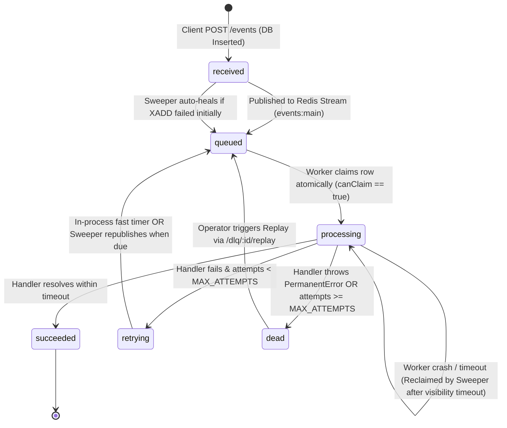

# EventFlow — Distributed Event Processing Platform

> A resilient, resume-grade distributed event ingestion and processing engine built with Node.js 20+ (plain JavaScript ESM), Fastify, PostgreSQL (Neon), and Redis Streams (Upstash). Features at-least-once delivery with idempotent execution, adaptive exponential backoff with full jitter, dead-letter queueing (DLQ), crash recovery via visibility timeouts, and a real-time dark/light monitoring dashboard.

[](#tests)
[](https://nodejs.org)
[-brightgreen)](#architecture)
[](LICENSE)

---

## Live Demo & Screenshots

- **Live URL:** [https://eventflow.onrender.com](https://eventflow.onrender.com) *(Hosted on Render Free Tier; initial request wakes container)*
- **Interactive Console:** Run sample scenarios (Echo, Flaky, Poison, Timeout, Crash, Burst) directly from the embedded dashboard without external tools.

```
+---------------------------------------------------------------------------------------------------+
|  ⚡ EventFlow   v1.0 • ESM           [ ● Postgres & Redis Online ]   [ API Key ]  [ ☀️ ]  [ ↻ Refresh ]  |
+---------------------------------------------------------------------------------------------------+
|  QUEUE DEPTH    IN FLIGHT       SUCCEEDED       RETRYING        DEAD-LETTER     THROUGHPUT    P95 LATENCY  |
|      0              0              14               0               2             12/min         42ms     |
+---------------------------------------------------------------------------------------------------+
|  THROUGHPUT ACTIVITY (LAST 30 MINUTES)                                                              |
|  [||||||||||||||||||||||||||||||||||||||||||||||||||||||||||||||||||||||||||||||||||||||||||||||]  |
+---------------------------------------------------------------------------------------------------+
|  INTERACTIVE DEMO CONSOLE: [Emit Success] [Emit Flaky] [Emit Poison] [Emit Crash] [Emit Burst x20]   |
+---------------------------------------------------------------------------------------------------+
```

---

## Architecture

EventFlow decouples event intake from asynchronous execution using a hybrid persistence and stream transport model:
- **PostgreSQL (Neon):** The durable source of truth. Stores all event records, payload hashes, state machine transitions, attempt audit logs, and final execution results.
- **Redis Streams (Upstash):** Low-latency transport queue. Stream entries carry lightweight pointers (`{ eventId }`), ensuring zero payload bloat in Redis while maintaining bounded memory via stream trimming (`MAXLEN ~`).
- **Worker Engine:** Adaptive polling consumer group (`eventflow`) that retrieves batches without blocking, claims rows atomically, executes registered handlers under timeouts, and schedules jittered retries.
- **Recovery Sweeper:** Background daemon that periodically audits Postgres and Redis to republish due retries, re-enqueue stuck received rows, and reclaim orphaned processing tasks via `XAUTOCLAIM`.

```mermaid
flowchart TD
    Client["Clients / HTTP API Consumers"] -->|POST /events| API["Fastify API Server"]
    
    subgraph Ingestion ["Ingestion & Deduplication"]
        API -->|1. Canonical SHA256| Hash["Payload Hash Check"]
        API -->|2. Idempotent Insert| PG[("PostgreSQL (Neon)\nSource of Truth")]
        API -->|3. XADD eventId| RS[("Redis Streams (Upstash)\nTransport Queue")]
        API -.->|4. wake()| Worker
    end

    subgraph Processing ["Worker Engine & Execution"]
        RS -->|XREADGROUP| Worker["Worker Loop\n(Adaptive Polling)"]
        Worker -->|Atomic Claim\nFOR UPDATE SKIP LOCKED| PG
        Worker -->|Run Handler with Timeout| Handlers["Handlers Registry\n(demo.echo, flaky, crash, etc.)"]
        Handlers -->|Success| AckSuccess["Record Attempt (success)\nMark Succeeded\nXACK"]
        Handlers -->|Transient Error| Backoff["Exponential Backoff + Jitter\nMark Retrying\nSchedule Fast Retry\nXACK"]
        Handlers -->|Exhausted / Permanent| DLQ["Mark Dead\nMirror to events:dlq\nXACK"]
        Handlers -.->|Simulated Crash| Crash["Record Attempt (crashed)\nNO ACK / Stays Processing"]
    end

    subgraph Recovery ["Self-Healing Sweeper"]
        Sweeper["Recovery Sweeper\n(Every 30s)"] -->|Due Retries| PG
        Sweeper -->|Stuck Received| PG
        Sweeper -->|Visibility Timeout\nXAUTOCLAIM| RS
        Crash -.->|Reclaimed after 30s| Sweeper
    end

    subgraph Observability ["Monitoring & Ops"]
        PG --> Dash["Vanilla HTML/CSS/JS Dashboard\n(/, /metrics, /metrics/prometheus)"]
        RS --> Dash
    end
```

---

## Event Lifecycle & State Machine

Every ingested event transitions through explicit states recorded in the `events` table:



---

## Delivery Semantics & Non-Guarantees

To ensure production honesty, EventFlow defines its exact operational guarantees:

| Semantic Feature | Status | Implementation Mechanism |
| :--- | :---: | :--- |
| **At-Least-Once Delivery** | **Guaranteed** | Every message must be explicitly acknowledged (`XACK`) by a worker. Unacknowledged messages remain in the stream Pending Entries List (PEL) and are reclaimed by the recovery sweeper after `VISIBILITY_TIMEOUT_MS`. |
| **Idempotent Processing** | **Guaranteed** | Side effects execute *effectively once*. At ingestion, duplicate keys with identical payloads return cached responses. At the worker layer, row-level atomic claim queries ensure only one worker processes an event. |
| **Strict FIFO Ordering** | **NOT Guaranteed** | Distinct events are processed concurrently across consumer group workers. Retry delays, handler durations, and visibility timeouts mean execution completion is non-sequential. |
| **Exactly-Once Across Network** | **NOT Guaranteed** | True distributed exactly-once across uncoordinated distributed boundaries is impossible. Network retries can cause duplicate stream messages; the platform makes duplicates benign. |

---

## Idempotency Architecture

Idempotency is enforced at two distinct system boundaries:

### 1. Ingestion Deduplication (API Layer)
When a client sends a request with an `Idempotency-Key` header (or body field):
1. The payload is canonicalized recursively (keys sorted alphabetically at all depths) and hashed via SHA-256.
2. The event is inserted using PostgreSQL `ON CONFLICT (idempotency_key) DO NOTHING`.
3. If a conflict occurs:
   - If the existing record has an identical `payload_hash`, the API returns HTTP `200 OK` with `{ duplicate: true, event }`.
   - If the payload differs, the API rejects with HTTP `422 Unprocessable Entity` (`idempotency_conflict`), preventing unintended mutations.

### 2. Execution Deduplication (Worker Layer)
If Redis delivers a duplicate stream message (or a sweeper re-enqueues an in-flight job):
1. The worker runs an atomic SQL claim query:
   ```sql
   UPDATE events
   SET status = 'processing',
       attempts = attempts + 1,
       started_at = now()
   WHERE id = $1
     AND (
       status IN ('queued', 'retrying')
       OR (status = 'processing' AND started_at <= now() - ($2 || ' milliseconds')::interval)
     )
   RETURNING *;
   ```
2. If no row is returned (because another worker claimed it or it already succeeded/died), the worker acknowledges the stream message immediately (`XACK`) and skips execution without running the handler.

---

## Retry Backoff with Full Jitter

Transient failures are retried using exponential backoff with full jitter to avoid the "thundering herd" problem on downstream dependencies:

$$\text{rawExponential} = \min\left(\text{RETRY\_MAX\_MS},\; \text{RETRY\_BASE\_MS} \times 2^{\text{attempt} - 1}\right)$$
$$\text{delay} = \text{round}\left(\text{rawExponential} \times \text{random}(0.5,\, 1.0)\right)$$

- Default configuration: `RETRY_BASE_MS = 2000`, `RETRY_MAX_MS = 60000`.
- **Attempt 1:** 1,000ms – 2,000ms delay.
- **Attempt 2:** 2,000ms – 4,000ms delay.
- **Attempt 3:** 4,000ms – 8,000ms delay.
- **Ceiling:** Delays never exceed `RETRY_MAX_MS` (60s).

---

## Dead-Letter Queue (DLQ) & Replay

When an event exceeds `MAX_ATTEMPTS` (default 4) or throws a `PermanentError` (e.g. invalid recipient account):
1. Its state in PostgreSQL is marked `status = 'dead'`, with `last_error` and `finished_at` updated.
2. An informational mirror entry is published to Redis Stream `events:dlq` (capped at `DLQ_MAXLEN = 1000`).
3. The original message in `events:main` is acknowledged and cleared from pending entries.
4. **Replay Workflow:** Operators can inspect errors in the dashboard and trigger `/dlq/:id/replay`. This resets `attempts = 0`, clears error logs, sets status back to `queued`, and republishes the ID to the main stream.

---

## Failure Mode Analysis

| Failure Scenario | System Reaction & Recovery Path |
| :--- | :--- |
| **Worker process crash (SIGKILL)** | Message remains pending in Redis PEL; row remains `processing`. After `VISIBILITY_TIMEOUT_MS` (30s), the recovery sweeper runs `XAUTOCLAIM`, re-assigning the message to a healthy worker. |
| **XADD fails after DB insert** | Event remains in Postgres as `status = 'received'`. The API returns HTTP `202 Accepted` to client. Within 30s, the sweeper picks up stuck received rows and queues them to Redis. |
| **Duplicate ingestion request** | Ingestion conflict check detects existing key. Returns HTTP 200 with the original event if payload matches, or HTTP 422 if payload changed. |
| **Poison message** | Worker executes handler, catches error, increments attempts, and schedules jittered backoff. Once reaching `MAX_ATTEMPTS`, marks event `dead` and mirrors to DLQ. |
| **Handler timeout (> 8s)** | Execution is wrapped in `withTimeout()`. Rejects with `TimeoutError`, records attempt as `timeout`, and enters standard backoff retry cycle. |
| **Redis connection outage** | Fastify health check reports degraded; API keeps writing to Postgres (`received`). Worker loop catches Redis errors, backs off 3s without crashing, and resumes when Redis reconnects. |
| **PostgreSQL connection outage** | Ingestion fails fast with HTTP 500/503. Worker catches query failures and does NOT ack messages, allowing them to remain safely in the stream until Postgres recovers. |
| **Render idle sleep / redeploy** | Render sends `SIGTERM`. Fastify stops accepting new traffic, workers wait up to 10s for active handlers, and connections close cleanly. Upon instance wake, migrations and sweeper auto-recover any pending jobs. |

---

## REST API Reference

All requests accept and return JSON. Restricted routes require header `x-api-key: <API_KEY>`. When `DEMO_MODE=true`, read endpoints and demo emission are public.

### Endpoints

| Method | Endpoint | Auth | Description |
| :--- | :--- | :---: | :--- |
| `POST` | `/events` | Key | Ingest a new event. Body: `{ type, payload, idempotencyKey?, maxAttempts? }`. Returns `202 { id, status }` or `200` (duplicate). |
| `GET` | `/events` | Read | List events with keyset pagination. Query params: `status`, `type`, `limit` (max 100), `before`. Payloads omitted for speed. |
| `GET` | `/events/:id` | Read | Get complete event record (including full payload, result, and attempts timeline). |
| `GET` | `/dlq` | Read | List dead-lettered events with failure diagnostics. |
| `POST` | `/dlq/:id/replay` | Demo / Key | Reschedule a dead-lettered event (resets attempts to 0 and requeues). |
| `POST` | `/dlq/:id/discard` | Key | Mark a dead event as discarded by operator. |
| `POST` | `/dlq/replay-all` | Key | Replay up to 100 dead-lettered events in batch. |
| `POST` | `/demo/emit` | Demo | Ingest sample scenarios: `{ scenario: 'success'\|'flaky'\|'poison'\|'permanent'\|'slow'\|'crash'\|'burst' }`. |
| `GET` | `/health` | Public | Fast dependency ping (`SELECT 1` on PG, `PING` on Redis, 2s timeout). Returns `200 { status: 'ok' }` or `503`. |
| `GET` | `/metrics` | Read | Aggregated counts, throughput series, p50/p95 latency, and worker info (cached 3s). |
| `GET` | `/metrics/prometheus`| Read | Prometheus text format exposition (`text/plain`). |

---

## Environment Variables

| Variable | Default | Purpose |
| :--- | :--- | :--- |
| `DATABASE_URL` | *Required* | PostgreSQL connection string (pooled URL with `sslmode=require`, without `channel_binding`). |
| `REDIS_URL` | *Required* | Redis connection string (`rediss://` TCP URL for ioredis, not REST). |
| `API_KEY` | *Required* | Master key for restricted ingestion and operator actions. |
| `PORT` | `10000` | HTTP port for Fastify server. |
| `ROLE` | `all` | Process role: `all` (API + Worker + Sweeper), `api` (HTTP only), or `worker` (Engine only). |
| `DEMO_MODE` | `true` | Allows public access to read endpoints, demo emitter, and DLQ replay for portfolio demonstrations. |
| `WORKER_CONCURRENCY`| `5` | Number of messages processed concurrently per batch by each worker. |
| `MAX_ATTEMPTS` | `4` | Maximum execution attempts before routing to Dead-Letter Queue. |
| `RETRY_BASE_MS` | `2000` | Initial exponential backoff delay in milliseconds. |
| `RETRY_MAX_MS` | `60000` | Upper ceiling for retry backoff in milliseconds. |
| `VISIBILITY_TIMEOUT_MS`| `30000` | Stale processing threshold before messages are reclaimed via `XAUTOCLAIM`. |
| `HANDLER_TIMEOUT_MS` | `8000` | Maximum execution time allowed for an individual event handler. |
| `IDLE_POLL_MAX_MS` | `60000` | Maximum adaptive sleep duration when stream has no messages. |
| `SWEEP_INTERVAL_MS`| `30000` | Interval between background sweeper audit passes. |
| `STREAM_MAXLEN` | `10000` | Maximum entries retained in `events:main` Redis stream (`MAXLEN ~`). |
| `DLQ_MAXLEN` | `1000` | Maximum entries retained in `events:dlq` mirror stream. |
| `LOG_LEVEL` | `info` | Fastify / Pino logging level (`info`, `warn`, `error`). |

---

## Cloud Free-Tier Optimization Strategy

1. **Upstash Redis Command Quotas:**
   - Standard polling loops consume hundreds of thousands of commands per day. EventFlow uses **adaptive backoff polling**: starts at 500ms and doubles on empty reads up to 60s.
   - When a new event is ingested, the API triggers an in-process `worker.wake()` signal, immediately resetting the poll timer to 0ms for instant execution without burning idle Redis commands.
2. **Neon Serverless Cold Starts:**
   - Neon scales compute to zero when inactive. EventFlow configures a small connection pool (`max: 5`) with a 10s connection timeout and a 3-stage exponential connection retry policy in `src/db.js` to absorb cold start latency smoothly.
3. **Render Sleep & Redeploy:**
   - Free instances shut down after 15 minutes of inactivity. When a request arrives, Render boots the container; EventFlow automatically runs idempotent migrations and triggers an immediate sweeper pass to resume any unfinished work.

---

## Local Development & Setup

### Prerequisites
- Node.js 20+ (ESM support)
- Hosted PostgreSQL database (e.g. Neon)
- Hosted Redis instance with TCP support (e.g. Upstash)
- Git Bash or standard terminal

### Setup Steps
```bash
# 1. Clone repository
git clone https://github.com/your-username/event-flow.git
cd event_flow

# 2. Install runtime dependencies only (zero devDependencies)
npm install

# 3. Configure environment
cp .env.example .env
# Edit .env with your Neon DATABASE_URL and Upstash REDIS_URL

# 4. Run database migrations
npm run migrate

# 5. Run core unit test suite
npm test

# 6. Start server (API + Worker + Sweeper + Dashboard)
npm start
```
Open [http://localhost:10000](http://localhost:10000) in your browser.

---

## Tests

The project includes an ultra-lean, zero-network unit test suite using Node's built-in `node:test` runner and dependency injection fakes:

```bash
npm test
```

### Coverage
1. `computeBackoff`: Validates exponential calculation and strictly asserts full jitter bounds ($[50\%, 100\%]$) and `maxMs` ceiling.
2. `decideAfterFailure`: Tests normal error retries vs dead-lettering at max attempts, and confirms `PermanentError` bypasses retries straight to DLQ.
3. `canClaim`: Verifies state machine claim eligibility across `queued`, `retrying`, fresh `processing`, and stale `processing` beyond visibility timeout.
4. `hashPayload`: Confirms recursive JSON key normalization ensures identical hashes regardless of object key ordering.
5. `withTimeout`: Tests promise resolution within budget and rejection with `TimeoutError` when exceeding deadlines.
6. `processMessage (Success)`: Simulates worker execution with in-memory fakes; confirms attempt audit insertion, status update to `succeeded`, and stream `XACK`.
7. `processMessage (Retry & DLQ)`: Confirms failed attempts trigger jittered retry scheduling with `XACK`, and final attempt triggers dead-lettering and DLQ publishing.
8. `processMessage (Deduplication & Crash)`: Confirms duplicate deliveries are acknowledged and skipped without handler execution, and simulated crashes preserve un-acked messages for sweeper reclamation.

---

## Render Deployment Guide

Deploying EventFlow to Render using Docker:

1. Push your repository to GitHub (ensure `.env` is omitted; `.gitignore` is pre-configured).
2. In the Render Dashboard, click **New +** &rarr; **Web Service**.
3. Connect your GitHub repository.
4. Configure service settings:
   - **Runtime:** `Docker`
   - **Instance Type:** `Free`
   - **Health Check Path:** `/health`
5. Under **Environment Variables**, configure the required keys:
   - `DATABASE_URL`: Your pooled Neon connection string (`sslmode=require`)
   - `REDIS_URL`: Your Upstash `rediss://` TCP URL
   - `API_KEY`: A strong random secret key
   - `ROLE`: `all`
   - `DEMO_MODE`: `true`
6. Click **Deploy Web Service**. Render builds the image using the provided `Dockerfile` and starts the service.

---

## Reference Architecture: Full Version with Apache Kafka

*(Reference Design Only — Not Exercised / Tested Locally)*

For large-scale enterprise deployments where Kafka is the enterprise standard, EventFlow's transport abstraction (`src/transport/base.js`) is architected to slot Kafka in place of Redis Streams:

- **Streams &rarr; Kafka Topics:** The `events:main` stream maps directly to an `events.main` topic partitioned across multiple brokers.
- **Consumer Groups &rarr; Kafka Consumer Groups:** Consumer group `eventflow` maps to a Kafka consumer group with automatic partition rebalancing and committed offset tracking.
- **Retry Strategy:** In Kafka, messages cannot easily be acknowledged out of order. Retries use a tiered retry topic architecture (`events.retry.10s`, `events.retry.1m`, etc.) with dead-lettering routed to `events.dlq`.
- **Reference Compose:** See [`docker-compose.full.yml`](file:///c:/Coding/r_projects/event_flow/docker-compose.full.yml) for a complete reference blueprint with Apache Kafka (KRaft mode), Postgres, Redis, and EventFlow.

---

## Known Limitations

- **Rate Limiting Scope:** The built-in rate limiter runs in memory per-instance. In a multi-instance horizontally scaled API deployment, rate limits apply per node rather than globally (can be upgraded to Redis sliding-window counters if needed).
- **Fast-Path In-Process Timers:** The fast-path retry mechanism uses an in-memory `setTimeout`. If an instance is abruptly terminated during a delay, the retry timer is lost; however, the durable PostgreSQL sweeper recovers the event on the next sweep pass.
- **Payload Max Size:** Hard-capped at 16 KB per event. Larger payloads should be stored in object storage (S3/GCS) with references passed in the event payload.

---

## Resume Highlights

- Engineered a distributed, fault-tolerant event processing platform with Fastify, PostgreSQL (Neon), and Redis Streams (Upstash), ensuring at-least-once delivery semantics and effectively-once execution via atomic row-level claim locks (`FOR UPDATE SKIP LOCKED`).
- Designed an adaptive polling worker consumer group that eliminates idle cloud command burn by exponentially scaling poll intervals from 500ms to 60s with an event-driven `wake()` signal for immediate burst processing.
- Implemented an automated background recovery sweeper utilizing Redis `XAUTOCLAIM` and visibility timeouts to recover tasks from crashed nodes, transient network outages, and expired retries.
- Built a zero-dependency vanilla HTML/CSS/JS real-time dashboard featuring live SVG throughput charts, keyset pagination, interactive failure simulation scenarios, and Prometheus metrics exposition.
